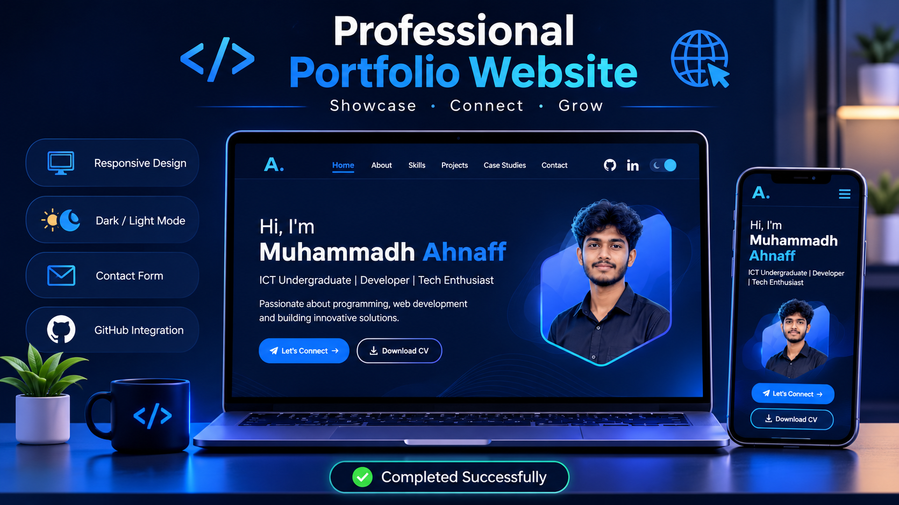

# Muhammadh Ahnaff | Personal Portfolio

<p align="center">
  
</p>

<h3 align="center">ICT Undergraduate | Aspiring Software Developer</h3>

<p align="center">
  <a href="https://ama-cypher.github.io/Muhammadh-Ahnaff-Portfolio/">Live Portfolio</a> •
  <a href="https://github.com/AMA-Cypher">GitHub</a> •
  <a href="https://www.linkedin.com/in/muhammadh-ahnaff-260844407/">LinkedIn</a>
</p>

---

## About This Project

This is my personal portfolio website, developed to showcase my educational background, technical skills, projects, experience, and professional journey as an ICT undergraduate at the University of Vavuniya.

The website provides a professional online presence for recruiters, developers, and potential collaborators to explore my work and connect with me.

## Technologies Used

| Technology | Purpose |
|---|---|
| HTML5 | Website structure |
| CSS3 | Styling, layouts, animations and responsive design |
| JavaScript | Interactive functionality |
| Git | Version control |
| GitHub | Source code hosting |
| GitHub Pages | Website deployment |
| Formspree | Contact form handling |

## Features

- Responsive design for desktop, tablet and mobile
- Dark mode and light mode
- Interactive navigation menu
- Profile picture showcase
- About Me and Education sections
- Technical skills showcase
- Project portfolio
- Experience and activities section
- Downloadable CV
- Contact form
- GitHub and LinkedIn links
- Smooth scrolling and animations

## Portfolio Sections

| Section | Description |
|---|---|
| Home | Introduction and profile showcase |
| About Me | Personal introduction and interests |
| Education | Academic background |
| Skills | Technical skills and tools |
| Projects | Academic and personal projects |
| Experience | University activities and leadership |
| Contact | Contact form and professional links |

## Featured Projects

### 1. Smart Bookshelf Organizer

An IoT-based bookshelf management system developed as a group project.

**Technologies:** ESP32, RFID, Firebase, IoT

**Key Features:**
- RFID-based book identification
- Book inventory management
- Firebase integration
- Real-time data communication

### 2. AI University Assistant

An AI-based university assistance project currently under development.

**Technologies:** Python, FastAPI

**Objective:** To develop an intelligent assistant that helps university students access useful academic information.

### 3. Professional Portfolio Website

A responsive personal portfolio website developed to present my academic and professional profile.

**Technologies:** HTML5, CSS3, JavaScript

**Key Features:**
- Dark and light themes
- Responsive layouts
- Interactive navigation
- Project showcase
- Contact form

**Status:** Completed

### 4. AttendEase – Student Attendance Management System

A planned student attendance management system.

**Planned Technologies:** C#, Windows Forms, SQL Server

**Objective:** To manage student attendance records, calculate attendance percentages, and identify students with low attendance.

**Status:** Planned

## Education

**Bachelor of Information and Communication Technology (Hons)**

University of Vavuniya, Sri Lanka

2025 – 2029

## Technical Skills

- **Programming:** Java, Python, C, C++, C#, JavaScript
- **Web Development:** HTML5, CSS3, JavaScript
- **Databases:** MySQL, Firebase
- **Frameworks and Tools:** FastAPI, Visual Studio, Visual Studio Code, XAMPP
- **Version Control:** Git, GitHub
- **Other Skills:** Computer Networking, Artificial Intelligence, Figma

## Run Locally

Follow these steps to run the portfolio website on your computer.

**1. Clone the repository**

```bash
git clone https://github.com/AMA-Cypher/Muhammadh-Ahnaff-Portfolio.git
```

**2. Open the project folder**

```bash
cd Muhammadh-Ahnaff-Portfolio
```

**3. Run the website**

Open `index.html` in your browser.

Alternatively, start a local Python server:

```bash
python -m http.server 8000
```

Then visit:

```text
http://localhost:8000
```

## Project Structure

```text
Muhammad-Ahnaff-Portfolio/
│
├── Assets/
│   ├── Documents/
│   │   └── Muhammadh-Ahnaff-CV.pdf
│   │
│   └── Images/
│       ├── profile.png
│       ├── profile.jpg
│       ├── SBO.jpeg
│       └── portfolio.png
│
├── CSS/
│   └── style.css
│
├── JS/
│   └── script.js
│
├── index.html
└── README.md
```

## Live Deployment

This portfolio website is deployed using GitHub Pages.

**Live Website:**  
https://ama-cypher.github.io/Muhammadh-Ahnaff-Portfolio/

Updates pushed to the `main` branch are published through GitHub Pages.

## Contact

**Muhammadh Ahnaff**

- Email: amanullahahnaff80@gmail.com
- GitHub: https://github.com/AMA-Cypher
- LinkedIn: https://www.linkedin.com/in/muhammadh-ahnaff-260844407/

---

<p align="center">
  Designed and developed by <strong>Muhammadh Ahnaff</strong>
</p>

<p align="center">
  <em>Always Learning. Always Building.</em>
</p>